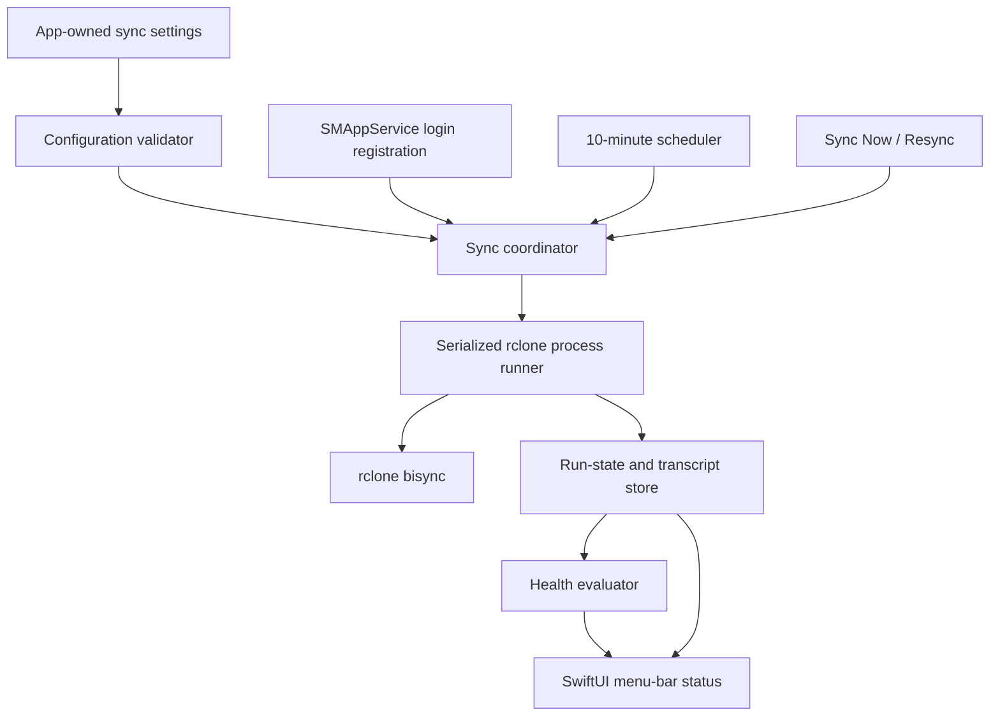
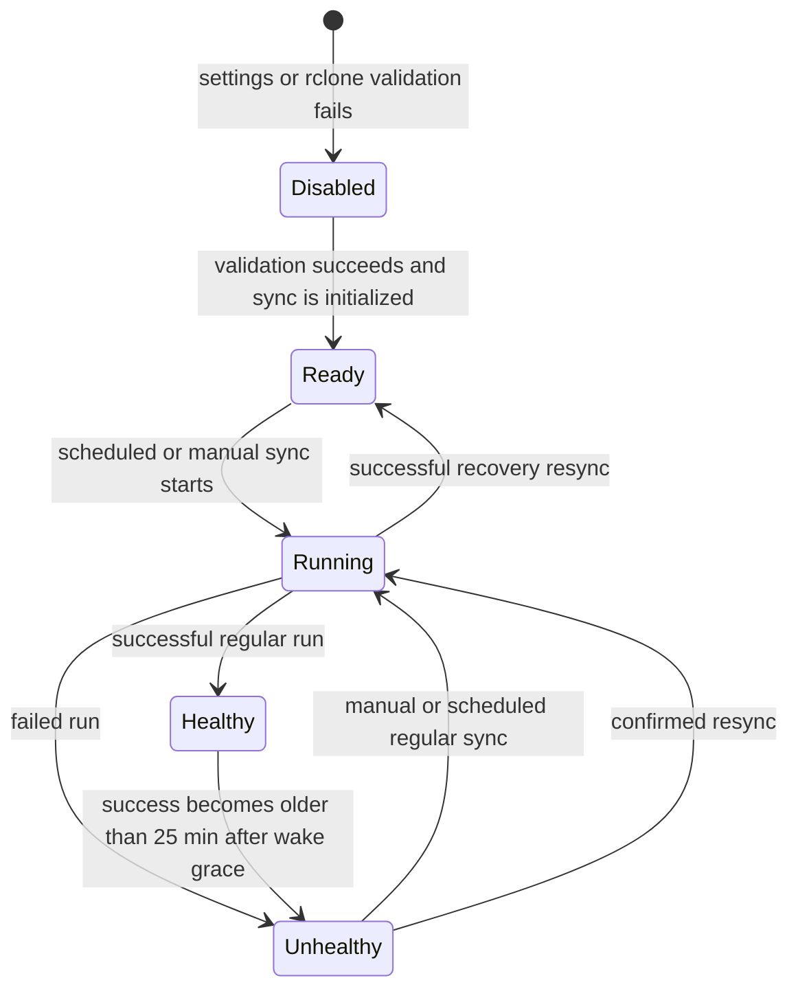

# Rclone Sync Guardian - Plan

## Goal Capsule

- **Objective:** Replace the hidden OneDrive rclone launch-agent workflow with a macOS 26 menu-bar app that makes sync health and recovery actions visible.
- **Product authority:** The Product Contract preserves the confirmed v1 behavior. The Planning Contract resolves the native macOS, persistence, and rclone-process approach.
- **Execution profile:** Build a native SwiftUI Xcode app with XCTest coverage around the scheduler, state model, settings validation, and rclone process boundary.
- **Stop conditions:** Do not add OneDrive OAuth setup, a graphical settings editor, history browsing beyond the latest run, or a second automatic scheduler alongside the Nix launch agent.
- **Tail ownership:** The owner supplies and maintains rclone credentials and the app-owned non-secret settings file.

---

## Product Contract

### Summary

Build a login-starting macOS menu-bar app that owns scheduled OneDrive rclone syncs and exposes their current health. Its menu presents the latest successful sync, the latest run's output, and manual sync and recovery actions.

### Problem Frame

The present rclone process runs through a background launch agent and writes separate logs. It provides no at-a-glance signal that a sync has failed, an external volume is unavailable, or a successful run has become stale, so its operator must remember to inspect logs manually.

### Key Decisions

- **Menu-first guardian:** v1 is a status and recovery companion, not a full rclone control centre. It replaces the hidden automatic sync workflow while keeping credential configuration responsibility with the user.
- **Short freshness window:** Run on a 10-minute cadence and consider a successful run fresh for 25 minutes after it completes. This makes a missed periodic run visible promptly without treating a brief delay as failure.
- **Single latest-run transcript:** Present the final 30 lines of the latest sync as one readable transcript that includes diagnostic error output.

### Requirements

**Lifecycle and configuration**

- R1. The app launches when the user logs in and owns the automatic OneDrive rclone sync schedule, running it every 10 minutes.
- R2. The app validates that a usable OneDrive rclone configuration exists before it enables syncing.
- R3. When configuration is missing or invalid, the app remains disabled and its menu states the reason, including that no valid rclone configuration was found when applicable.

**Health and visibility**

- R4. The menu-bar icon communicates at a glance whether syncing is healthy, currently running, disabled for invalid configuration, or unhealthy.
- R5. The app marks the sync unhealthy whenever its most recent run fails for any reason, including an unavailable external volume.
- R6. The app also marks the sync unhealthy when no successful sync has completed in the preceding 25 minutes after the Mac has been awake for at least 25 minutes.
- R7. The app menu displays the most recent successful sync time inline with its current status.
- R8. Hovering over or selecting the latest-sync menu item reveals a submenu containing the final 30 lines of the latest run transcript.

**Recovery actions**

- R9. The app menu provides an action to trigger a regular sync immediately.
- R10. The app menu provides an action to trigger a recovery resync, preceded by a native confirmation dialog with Confirm and Cancel choices.

### Actors

- A1. **Mac owner:** Configures rclone externally, maintains the app-owned sync settings, reads sync health, and initiates manual sync or recovery when needed.
- A2. **rclone:** Performs scheduled and user-triggered OneDrive synchronization and supplies the run outcome and output.

### Key Flows

- F1. Scheduled healthy sync
  - **Trigger:** The 10-minute schedule is due while the app has valid settings and a usable rclone configuration.
  - **Actors:** A1, A2.
  - **Steps:** The app runs a regular sync, records its outcome and transcript, then updates the icon and latest-success time.
  - **Outcome:** A successful run keeps the app healthy for 25 minutes.

- F2. Invalid configuration
  - **Trigger:** The app starts or validates configuration and cannot use a OneDrive rclone remote.
  - **Actors:** A1.
  - **Steps:** The app disables syncing and reports the reason in its menu.
  - **Outcome:** The owner corrects the settings or rclone configuration outside the app and returns to the status menu.

- F3. Manual recovery
  - **Trigger:** The owner selects Resync from the menu.
  - **Actors:** A1, A2.
  - **Steps:** The app asks the owner to confirm or cancel. On confirmation, it runs the recovery resync and updates the latest-run transcript and health.
  - **Outcome:** The owner can deliberately recover from a failed or stale synchronization.

### Acceptance Examples

- AE1. **Covers R3.** Given no valid OneDrive rclone configuration, when the app launches, then it shows a disabled status and the menu explains that no valid rclone configuration was found.
- AE2. **Covers R5, R8.** Given the latest sync fails because its external volume is unavailable, when the run ends, then the icon shows unhealthy and the latest-sync submenu includes the relevant final output lines.
- AE3. **Covers R6.** Given the Mac has been awake for 25 minutes and no successful sync has completed within that period, when the app evaluates health, then it shows unhealthy.
- AE4. **Covers R10.** Given the owner selects Resync, when the confirmation dialog appears and the owner cancels, then no recovery resync begins.

### Scope Boundaries

- Creating, authenticating, editing, or otherwise managing rclone and OneDrive credentials is out of scope for v1.
- Browsing run history beyond the latest run is out of scope for v1.
- A full settings or dashboard window is out of scope for v1; the menu bar is the primary interface.
- The app does not unload, rewrite, or manage the existing Nix launch agent. Migration disables that agent before this app's schedule is enabled.

### Dependencies / Assumptions

- rclone is installed and a usable OneDrive remote has been configured by the owner outside the app.
- The app will replace the existing automatic sync mechanism so two automatic rclone syncs do not run concurrently.
- The rclone configuration may target an external volume; its unavailability is an ordinary sync failure and must be surfaced as such.

---

## Planning Contract

### Key Technical Decisions

- KTD1. **Use an Xcode macOS app target with SwiftUI `MenuBarExtra`.** macOS 26 exceeds the API baseline for a menu-bar-only SwiftUI app and `SMAppService` login registration. The menu style supports a native nested menu for the latest-run transcript without a separate dashboard window.
- KTD2. **Keep sync settings separate from rclone credentials.** Store only the executable path, rclone config path, remote name, local mirror path, and 10-minute interval in an app-owned JSON file under Application Support. Validate the executable and remote by invoking rclone; do not parse credential-bearing configuration content.
- KTD3. **Persist latest-run state and a single transcript.** Save start and finish times, outcome, failure reason, and last-success time separately from a capped latest-run log. On restart, reconstruct the menu state before the next scheduled run.
- KTD4. **Serialize all rclone work through one runner.** Scheduled, Sync Now, and Resync requests share one execution gate. An active run disables competing actions rather than spawning a second `bisync` process.
- KTD5. **Preserve the existing sync profile and make resync opt-in.** Regular runs retain the established `bisync` safety and OneDrive flags, including access checking, Personal Vault exclusion, resilient behavior, fast listing, and OneDrive delta support. Only the confirmed Resync action adds `--resync`; it is never an automatic retry path.
- KTD6. **Let rclone determine when recovery is required.** The legacy bootstrap marker cannot reliably prove that a changed app setting belongs to the same sync pair. Run only normal syncs automatically, record any rclone recovery-required failure as unhealthy, and leave the confirmed Resync action as the sole recovery path.
- KTD7. **Use main-app login registration.** Register the main app through `SMAppService` and surface a clear menu warning if macOS has not approved or has disabled the login item.

### High-Level Technical Design

### Settings and Compatibility

- The first-run settings template uses the current mirror's local path, the `onedrive` remote, the current rclone configuration location, and an `intervalSeconds` value of `600`.
- `rcloneExecutablePath` is required because a login item cannot depend on an interactive shell's `PATH`; the owner sets it to the current host's Nix-managed rclone binary.
- The template contains no refresh token, client secret, or other OneDrive credential. Invalid, missing, unreadable, or stale settings remain a disabled state with a remediation reason.
- Compatibility with the existing Nix setup includes its configured remote/local paths and its `bisync` options. The app does not rely on the legacy bootstrap-complete marker because it cannot associate that marker with changed settings safely.

### Sequencing

1. Establish the Xcode app, app-support locations, and test harness.
2. Add testable settings, run-state, health, and transcript primitives.
3. Implement validation and a serialized rclone runner with the existing sync profile.
4. Add lifecycle scheduling and login registration.
5. Bind the resulting state and actions to the menu-bar interface.
6. Document setup, migration away from the launch agent, and recovery behavior.

### Risks and Dependencies

- **Destructive recovery:** `bisync --resync` can overwrite one side according to its mode. Mitigation: expose it only through the explicit native confirmation and never schedule it as a retry.
- **Interrupted synchronization:** `bisync` depends on working listings and can require a resync after certain failures. Mitigation: preserve the normal failure result and require the owner to choose the confirmed recovery action.
- **Unavailable external volume:** The local mirror can disappear while the Mac is awake. Mitigation: validate the configured volume before every run, report the failure, and never create a missing volume-root path.
- **Duplicate schedulers:** The old Nix launch agent and the app can each start rclone. Mitigation: document migration as a prerequisite and serialize all app-originated work.
- **Login-item approval:** macOS can deny or later disable login launch. Mitigation: keep the manually launched app usable and expose the registration state with a route to the relevant system settings.
- **Sensitive transcripts:** rclone output can reveal file paths and service diagnostics. Mitigation: retain only the latest local transcript under the app's support directory and add no telemetry or remote log upload.

### System-Wide Impact

- The app becomes the only automatic scheduler for this sync. The existing Nix configuration retains responsibility for installing rclone and managing credentials until the owner removes or disables its launch agent.
- Settings, state, and latest-run output are separate local artifacts. Settings contain configuration references only, state determines health after restart, and the transcript is diagnostic data with local-only retention.
- All user-visible statuses derive from one coordinator-owned state model. The status icon, inline menu text, action enablement, and transcript submenu must not calculate conflicting health independently.

---

## Implementation Units

### U1. Create the native app shell and local storage boundary

- **Goal:** Establish a macOS 26 SwiftUI/Xcode app, its XCTest target, and the app-support paths used by all later units.
- **Requirements:** R1, R2, R3.
- **Dependencies:** None.
- **Files:** `OneDriveRcloneMenubar.xcodeproj`, `OneDriveRcloneMenubar/App/OneDriveRcloneMenubarApp.swift`, `OneDriveRcloneMenubar/Support/AppPaths.swift`, `OneDriveRcloneMenubarTests/AppPathsTests.swift`.
- **Approach:** Create a menu-bar-only app target with `LSUIElement` enabled and a named test scheme. Centralize Application Support, latest-run transcript, persisted-state, and settings-template paths so no feature writes arbitrary files. Create the non-secret settings template if absent, but leave invalid required values visible to validation rather than silently guessing them.
- **Test scenarios:** Verify path construction stays inside the app support directory; a first-run template contains the current mirror, remote, config-path, and interval defaults; existing settings are never overwritten.
- **Verification:** The project builds as a menu-bar-only macOS 26 app and its test target can create isolated storage roots.

### U2. Model settings, run state, health, and transcript persistence

- **Goal:** Provide pure, testable state logic that can drive the icon and menu across app restarts.
- **Requirements:** R2, R3, R4, R5, R6, R7, R8.
- **Dependencies:** U1.
- **Files:** `OneDriveRcloneMenubar/Domain/SyncSettings.swift`, `OneDriveRcloneMenubar/Domain/SyncStatus.swift`, `OneDriveRcloneMenubar/Domain/HealthEvaluator.swift`, `OneDriveRcloneMenubar/Infrastructure/SettingsStore.swift`, `OneDriveRcloneMenubar/Infrastructure/RunStateStore.swift`, `OneDriveRcloneMenubar/Infrastructure/TranscriptStore.swift`, `OneDriveRcloneMenubarTests/HealthEvaluatorTests.swift`, `OneDriveRcloneMenubarTests/SettingsStoreTests.swift`, `OneDriveRcloneMenubarTests/RunStateStoreTests.swift`, `OneDriveRcloneMenubarTests/TranscriptStoreTests.swift`.
- **Approach:** Define settings for executable, rclone config, remote, local path, and interval. Persist a single latest-run record plus a bounded transcript and calculate disabled, running, healthy, and unhealthy presentation states from validation, run outcome, last success, and wake grace.
- **Test scenarios:** A valid recent success is healthy; a failed run is unhealthy immediately; a missing success stays non-stale during the first 25 awake minutes and becomes unhealthy afterward; invalid settings are disabled with their reason; restart loading preserves last-success time and only the final 30 transcript lines are exposed.
- **Verification:** All status transitions required by the Product Contract are covered without launching rclone.

### U3. Validate configuration and execute rclone through one serialized boundary

- **Goal:** Safely translate validated settings into normal-sync and confirmed-resync processes while recording a complete latest-run result.
- **Requirements:** R2, R3, R5, R8, R9, R10.
- **Dependencies:** U2.
- **Files:** `OneDriveRcloneMenubar/Infrastructure/RcloneValidator.swift`, `OneDriveRcloneMenubar/Infrastructure/RcloneProcessRunner.swift`, `OneDriveRcloneMenubar/Features/Sync/SyncCoordinator.swift`, `OneDriveRcloneMenubarTests/RcloneValidatorTests.swift`, `OneDriveRcloneMenubarTests/RcloneProcessRunnerTests.swift`, `OneDriveRcloneMenubarTests/SyncCoordinatorTests.swift`, `OneDriveRcloneMenubarTests/Fixtures/fake-rclone`.
- **Approach:** Invoke the configured executable with a constrained validation command and environment that points at the configured rclone config, confirming the configured remote exists without inspecting secrets. Route standard and recovery requests through one coordinator that refuses a second active process. Direct both rclone output streams into the same per-run transcript file, retain the final 30 lines for display, and atomically persist the outcome on exit. Recreate the current Nix `bisync` profile for regular runs and add `--resync` only after the UI confirms recovery.
- **Patterns to follow:** Isolate operating-system process work behind a protocol so the coordinator and UI tests use deterministic fakes. Keep process exit, transcript persistence, and health recomputation in the same completion path.
- **Execution note:** Start with fake-process tests for invocation shape, exit handling, and mutual exclusion before connecting the coordinator to the menu.
- **Test scenarios:** A missing executable, unreadable config path, or absent remote produces a disabled reason; a non-zero rclone exit records unhealthy state and error output; success updates last-success time; a second manual action while a process is active is rejected; normal sync omits `--resync`; confirmed recovery includes it; cancellation prevents process launch; an rclone recovery-required exit remains unhealthy until the owner confirms resync.
- **Verification:** Process-boundary tests prove no concurrent rclone invocation and no automatic recovery resync.

### U4. Add scheduling, wake-aware freshness, and login-item registration

- **Goal:** Make the app run on login and maintain the 10-minute schedule without declaring a newly awakened Mac stale prematurely.
- **Requirements:** R1, R4, R6.
- **Dependencies:** U2, U3.
- **Files:** `OneDriveRcloneMenubar/Features/Lifecycle/SyncScheduler.swift`, `OneDriveRcloneMenubar/Features/Lifecycle/WakeMonitor.swift`, `OneDriveRcloneMenubar/Features/Lifecycle/LoginItemManager.swift`, `OneDriveRcloneMenubarTests/SyncSchedulerTests.swift`, `OneDriveRcloneMenubarTests/WakeMonitorTests.swift`, `OneDriveRcloneMenubarTests/LoginItemManagerTests.swift`.
- **Approach:** Start scheduling only after settings validation succeeds. Feed wake and clock events into the health evaluator, and expose registration status from `SMAppService` so the menu can explain when login launch is not approved. Keep timer and clock dependencies injectable for deterministic tests.
- **Patterns to follow:** Keep lifecycle adapters thin; they publish events to the coordinator rather than making independent sync or health decisions.
- **Test scenarios:** The scheduler requests a run every 600 seconds; invalid settings prevent scheduled normal runs; a wake resets the 25-minute grace window; login registration success, denial, and already-registered states map to understandable presentation state.
- **Verification:** Tests prove cadence and wake freshness behavior without waiting for wall-clock time or changing real login-item configuration.

### U5. Build the menu-bar status and recovery interface

- **Goal:** Present the current state, latest success, transcript submenu, and user-triggered actions in the native menu bar.
- **Requirements:** R3, R4, R7, R8, R9, R10.
- **Dependencies:** U2, U3, U4.
- **Files:** `OneDriveRcloneMenubar/Features/MenuBar/MenuBarView.swift`, `OneDriveRcloneMenubar/Features/MenuBar/MenuBarViewModel.swift`, `OneDriveRcloneMenubar/Features/MenuBar/StatusIcon.swift`, `OneDriveRcloneMenubarTests/MenuBarViewModelTests.swift`.
- **Approach:** Use `MenuBarExtra` with menu style and a nested `Menu` for latest-run output. Bind the status icon, action availability, disabled reason, recent-success label, and running progress to the coordinator's observable state. Present the Resync confirmation through a native SwiftUI confirmation dialog and avoid starting a process until its affirmative action.
- **Patterns to follow:** Render from one view-model snapshot so the icon and every menu item reflect the same state transition.
- **Test scenarios:** Each presentation state selects the expected icon and status label; a valid run exposes exactly the final 30 transcript lines; invalid settings display the reason and disable actions; Sync Now delegates once; Resync cancellation delegates zero times and confirmation delegates once; active work disables both action controls.
- **Verification:** View-model tests prove the menu never presents a healthy state after a failure or stale success, and manual recovery remains confirmation-gated.

### U6. Document installation, migration, and operational recovery

- **Goal:** Make the external configuration and handover from Nix safe and repeatable.
- **Requirements:** R1, R2, R3, R9, R10.
- **Dependencies:** U1, U3, U4, U5.
- **Files:** `README.md`, `docs/settings.example.json`.
- **Approach:** Replace the placeholder README with installation prerequisites, the app-owned settings schema and example, rclone remote validation expectations, menu-state meanings, and manual recovery guidance. State that the existing `homeNetwork.onedriveRclone` launch agent must be disabled before enabling automatic app scheduling, while rclone and OneDrive credentials remain externally managed.
- **Test expectation:** None — this unit changes documentation and a checked-in example only.
- **Verification:** A new owner can identify the required rclone executable, config path, remote, local mirror, cadence, migration step, and meaning of disabled, unhealthy, and recovery states from the documentation alone.

---

## Verification Contract

| Gate | Applies to | Completion signal |
| --- | --- | --- |
| `xcodebuild -project OneDriveRcloneMenubar.xcodeproj -scheme OneDriveRcloneMenubar -destination 'platform=macOS' build` | U1-U6 | The production app target builds for macOS 26. |
| `xcodebuild -project OneDriveRcloneMenubar.xcodeproj -scheme OneDriveRcloneMenubar -destination 'platform=macOS' test` | U1-U5 | XCTest covers state, persistence, scheduling, validation, runner, and menu-view-model behavior. |
| Manual smoke check with a copied settings file and fake rclone executable | U3-U5 | The menu shows disabled, running, healthy, unhealthy, transcript, Sync Now, and cancellation-gated Resync states without accessing OneDrive. |
| Manual migration smoke check | U4-U6 | Disabling the Nix launch agent, enabling the app login item, and restarting yields one active scheduler rather than two. |

---

## Definition of Done

- The app is a macOS 26 menu-bar-only SwiftUI application that registers to launch on login and surfaces any registration problem.
- A valid configured sync runs no more than once at a time on the 10-minute cadence, and the latest outcome persists across restart.
- The icon and menu correctly distinguish disabled, running, healthy, and unhealthy states, including the 25-minute awake freshness rule.
- The menu exposes the latest success time, the last 30 combined transcript lines, Sync Now, and a confirmed-only Resync action.
- No automated test requires a live OneDrive account, real rclone configuration, or a real sync directory.
- The README and settings example describe the required external configuration and the migration away from the Nix launch agent.
- The final change contains no abandoned experiment code or a second automatic scheduler.

---

## Appendix

### Sources and Research

- The current Nix workflow, including the existing `bisync` flags, external-volume guard, bootstrap marker, and launch-agent implementation: [darwin-rclone.nix](https://raw.githubusercontent.com/craigjperry2/home-network/refs/heads/main/nix/modules/home/darwin-rclone.nix).
- Apple documents `MenuBarExtra` as a persistent menu-bar control and supports menu or popover-like window styles: [MenuBarExtra](https://developer.apple.com/documentation/swiftui/menubarextra).
- Apple documents `SMAppService.mainApp` for launching the main application at login, with registration subject to user approval: [mainAppService](https://developer.apple.com/documentation/servicemanagement/smappservice/mainapp) and [register()](https://developer.apple.com/documentation/servicemanagement/smappservice/register()).
- rclone documents that normal `bisync` follows an initial `--resync`, that `--check-access` is a data-loss safeguard, and that `--resync` should be restricted to particular recovery circumstances: [Bisync documentation](https://rclone.org/bisync/).
